# Unit Testing Demo: A Calculator in Python and Java

This repository teaches **unit testing** with one small, familiar program: a console calculator.
The same calculator is written twice, once in **Python** (tested with `unittest`) and once in **Java** (tested with **JUnit 4**).

You will:

1. Run the calculator as a normal console app.
2. Run the unit tests and read the results.
3. Break the code on purpose and watch a test catch the bug.
4. Make the most common beginner mistakes on purpose, so you recognise them later.
5. Learn the most useful `assert` methods in both languages.

Every step has the exact command for **macOS** and **Windows**, plus a screenshot of what you should see.

---

## Table of contents

- [What is unit testing and why should I care?](#what-is-unit-testing-and-why-should-i-care)
- [What is inside this repository](#what-is-inside-this-repository)
- [Step 0: Get the code](#step-0-get-the-code)
- [Part A: Python](#part-a-python)
  - [A1. Check Python is installed](#a1-check-python-is-installed)
  - [A2. Look at the code](#a2-look-at-the-code)
  - [A3. Run the calculator app](#a3-run-the-calculator-app)
  - [A4. Read a unit test](#a4-read-a-unit-test)
  - [A5. Run all the tests](#a5-run-all-the-tests)
  - [A6. Run only one test](#a6-run-only-one-test)
  - [A7. Let a test find a bug](#a7-let-a-test-find-a-bug)
  - [A8. Remove a safety check and see an ERROR](#a8-remove-a-safety-check-and-see-an-error)
  - [A9. Common Python mistakes](#a9-common-python-mistakes)
  - [A10. Python assert methods](#a10-python-assert-methods)
- [Part B: Java](#part-b-java)
  - [B1. Check Java is installed](#b1-check-java-is-installed)
  - [B2. Look at the code](#b2-look-at-the-code)
  - [B3. Compile and run the calculator app](#b3-compile-and-run-the-calculator-app)
  - [B4. Read a unit test](#b4-read-a-unit-test)
  - [B5. Run all the tests](#b5-run-all-the-tests)
  - [B6. Let a test find a bug](#b6-let-a-test-find-a-bug)
  - [B7. Common Java mistakes](#b7-common-java-mistakes)
  - [B8. JUnit assert methods](#b8-junit-assert-methods)
- [FAIL vs ERROR](#fail-vs-error)
- [Python vs Java side by side](#python-vs-java-side-by-side)
- [Exercises](#exercises)

---

## What is unit testing and why should I care?

A **unit** is the smallest piece of code that does one job, usually one function or one method.
A **unit test** is a tiny program that calls that unit with a known input and checks that the output is what you expect.

```text
calc.add(2, 3)   -->   should give 5   -->   PASS or FAIL
```

Why bother?

| Without unit tests | With unit tests |
|---|---|
| You test by hand: run the app, type numbers, read the screen. Slow and boring, so you skip it. | One command checks 20 cases in under a second. |
| A change in one place silently breaks something else. You find out from your user or your marker. | The test that covers the broken part goes red immediately and tells you the file and line. |
| You are scared to clean up or improve old code. | You can change code with confidence: if the tests stay green, nothing you tested broke. |

Every test in this repository follows the same three-part shape, called **Arrange, Act, Assert**:

```python
calc = Calculator()          # Arrange: set up what you need
result = calc.add(2, 3)      # Act:     call the code you are testing
assert result == 5           # Assert:  check the answer
```

The everyday workflow looks like this:

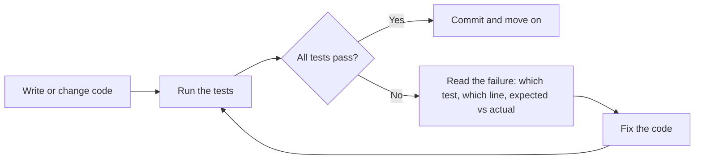

---

## What is inside this repository

```text
unit-testing-demo/
├── python/
│   ├── calculator.py         <- the Calculator class (the code we test)
│   ├── main.py               <- console menu that uses Calculator
│   └── test_calculator.py    <- unit tests for Calculator
├── java/
│   ├── src/
│   │   ├── Calculator.java   <- the Calculator class (the code we test)
│   │   └── Main.java         <- console menu that uses Calculator
│   ├── test/
│   │   └── CalculatorTest.java  <- unit tests for Calculator
│   ├── run-app.bat / run-app.sh      <- compile and start the app
│   ├── run-tests.bat / run-tests.sh  <- compile and run the tests
│   └── lib/
│       ├── junit-4.13.2.jar        <- JUnit testing library
│       └── hamcrest-core-1.3.jar   <- small library JUnit 4 needs
├── .vscode/settings.json     <- lets VS Code find and run the tests
└── screenshots/              <- images used in this README
```

Notice the pattern: **the code and its tests live in separate files**. `main.py` / `Main.java` is the program a user runs. The test file is a second program that only you, the developer, run.

The calculator has nine small methods:

| Method (Python / Java) | Example | Special case |
|---|---|---|
| `add` | `add(2, 3)` gives `5` | |
| `subtract` | `subtract(10, 4)` gives `6` | |
| `multiply` | `multiply(7, 0)` gives `0` | |
| `divide` | `divide(1, 3)` gives `0.333...` | dividing by 0 raises an error |
| `power` | `power(2, 3)` gives `8` | |
| `square_root` / `squareRoot` | `square_root(16)` gives `4.0` | a negative number raises an error |
| `is_even` / `isEven` | `is_even(4)` gives `True` | |
| `factors` | `factors(6)` gives `[1, 2, 3, 6]` | |
| `largest` | `largest([3, 9, 2])` gives `9` | an empty list gives `None` / `null` |

---

## Step 0: Get the code

You need **Git** installed. Check with `git --version`. If it is missing, install it from <https://git-scm.com/downloads> (Windows) or run `xcode-select --install` (macOS).

Open a terminal:

- **macOS:** press `Cmd + Space`, type **Terminal**, press Enter.
- **Windows:** press the Start button, type **PowerShell**, press Enter.

Then run:

```bash
git clone https://github.com/mdalmaruf/unit-testing-demo.git
cd unit-testing-demo
```

No Git? Click the green **Code** button on the GitHub page, choose **Download ZIP**, unzip it, and open your terminal inside the unzipped folder.

> **Tip:** You can also open the folder in VS Code (`File > Open Folder`) and use its built-in terminal (`View > Terminal`). All commands below work there too.

---

# Part A: Python

Python comes with a testing library called **`unittest`** built in. Nothing extra to install.

## A1. Check Python is installed

| macOS | Windows |
|---|---|
| `python3 --version` | `python --version` |

**What you should see:** a version number. Anything from 3.8 upwards is fine. Your number may differ from the screenshot.

**macOS**

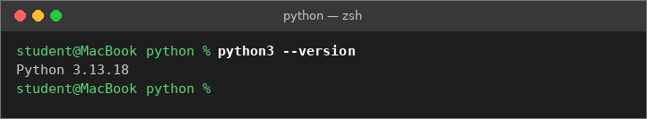

**Windows**

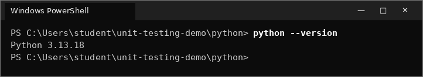

**If it does not work:**

- **macOS:** install Python from <https://www.python.org/downloads/>, then close and reopen Terminal.
- **Windows:** install from <https://www.python.org/downloads/>. On the first installer screen **tick "Add python.exe to PATH"**. If you forget, Windows will not find `python`. If typing `python` opens the Microsoft Store, use `py` instead of `python` in every command below.

**Why this matters:** every later step uses this command. If this step fails, nothing else will work, so fix it first.

## A2. Look at the code

Move into the Python folder:

```bash
cd python
```

Open `calculator.py`. Here are two of its methods:

```python
class Calculator:

    def subtract(self, a, b):
        return a - b

    def divide(self, a, b):
        if b == 0:
            raise ValueError("Cannot divide by zero")
        return a / b
```

`main.py` creates one `Calculator` and calls its methods from a menu:

```python
calc = Calculator()
...
if choice == "1":
    a = read_number("First number: ")
    b = read_number("Second number: ")
    print("Result:", calc.add(a, b))
```

Notice that `main.py` only handles input and output. All the real logic is in `Calculator`. That separation is what makes the logic easy to unit test: a test can call `calc.add(2, 3)` directly without typing anything into a menu.

## A3. Run the calculator app

| macOS | Windows |
|---|---|
| `python3 main.py` | `python main.py` |

Try: option `1` with `7` and `5`, then option `4` with `10` and `0`, then `0` to exit.

**What you should see:** `Result: 12.0` for the addition, a friendly `Error: Cannot divide by zero` for the division, and `Goodbye!` at the end.

**macOS**

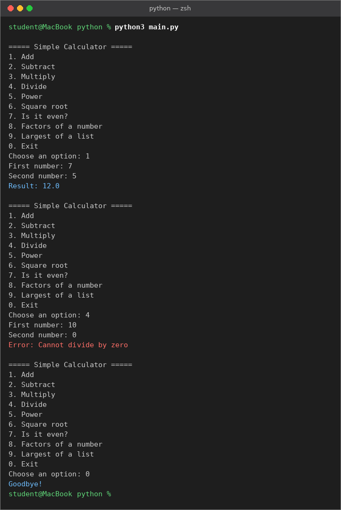

**Windows**

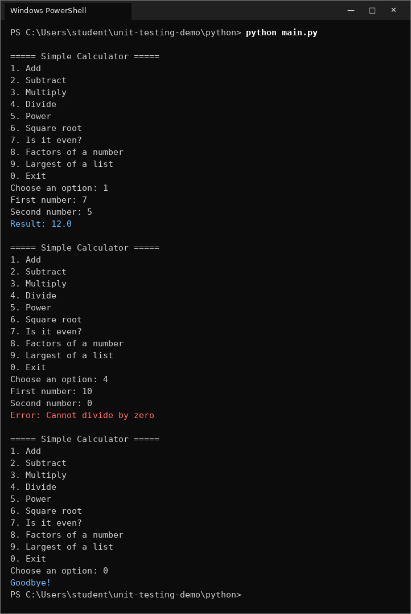

**Why this matters:** this is how a user sees the program. Checking it by hand works once, but you would have to repeat all of this after every change. The tests in the next steps do that checking for you automatically.

## A4. Read a unit test

Open `test_calculator.py`:

```python
import unittest
from calculator import Calculator


class TestCalculator(unittest.TestCase):      # 1. a test class inherits from unittest.TestCase

    def setUp(self):                           # 2. runs before EVERY test
        self.calc = Calculator()

    def test_add_two_positive_numbers(self):   # 3. name MUST start with test_
        self.assertEqual(self.calc.add(2, 3), 5)   # 4. the check

    def test_divide_by_zero_raises_error(self):
        with self.assertRaises(ValueError):    # 5. this code MUST raise ValueError
            self.calc.divide(5, 0)
```

1. **The test class** groups related tests. It must inherit from `unittest.TestCase`.
2. **`setUp`** gives every test a fresh `Calculator`. If one test changed the calculator, the next test would not be affected.
3. **The `test_` prefix** is how `unittest` finds tests. A method without it is silently ignored (you will see this in A9).
4. **`assertEqual(actual, expected)`** passes if the two values are equal and fails otherwise.
5. **`assertRaises`** checks that bad input is rejected. Testing the "unhappy path" is just as important as testing normal input.

## A5. Run all the tests

Make sure you are inside the `python` folder, then:

| macOS | Windows |
|---|---|
| `python3 -m unittest -v` | `python -m unittest -v` |

`-m unittest` tells Python to run the `unittest` tool. It searches the current folder for files named `test*.py` and runs every method starting with `test_`. The `-v` flag (verbose) prints one line per test.

**What you should see:** 20 lines ending in `... ok`, then `Ran 20 tests` and `OK`.

**macOS**

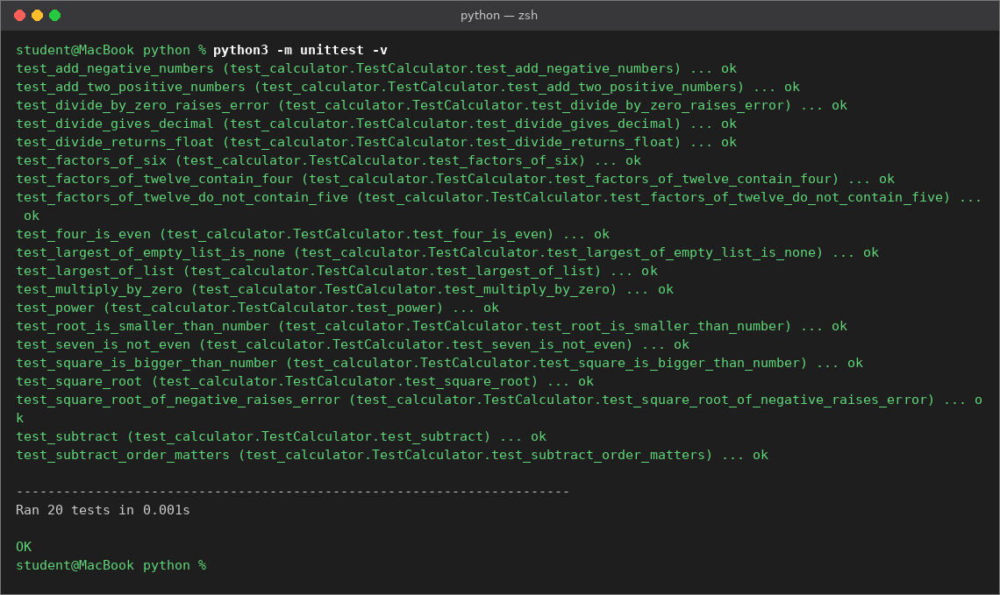

**Windows**

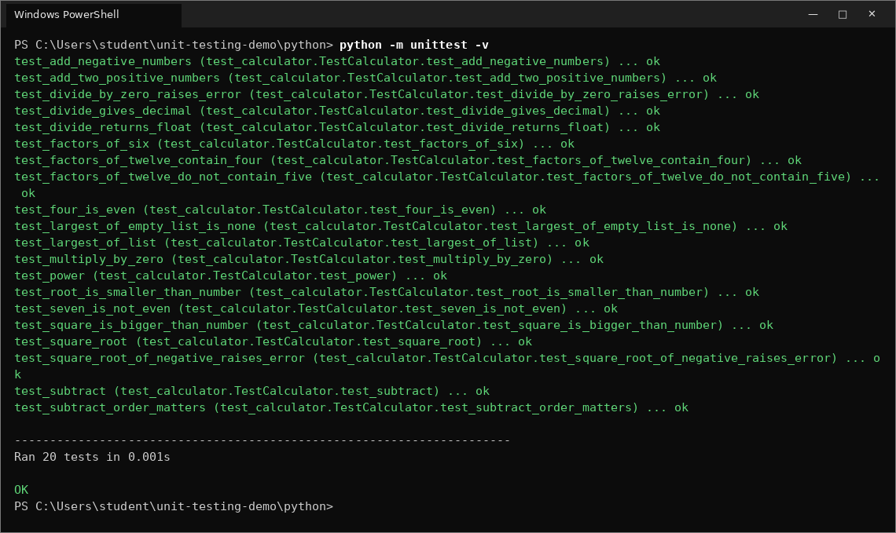

Without `-v` you get one character per test instead:

| Symbol | Meaning |
|---|---|
| `.` | test passed |
| `F` | **Fail**: an assert was false (the code gave the wrong answer) |
| `E` | **Error**: the code crashed with an unexpected exception |
| `s` | test was skipped |

**In VS Code:** click the flask icon (**Testing**) in the left bar, then the play button at the top. Each test gets a green tick or red cross. You need the Python extension installed.

**Why this matters:** `OK` means all 20 checks passed in a fraction of a second. Doing the same 20 checks by hand in the menu would take several minutes.

## A6. Run only one test

When you are fixing one problem you often want to run just one test:

| macOS | Windows |
|---|---|
| `python3 -m unittest -v test_calculator.TestCalculator.test_divide_by_zero_raises_error` | `python -m unittest -v test_calculator.TestCalculator.test_divide_by_zero_raises_error` |

The pattern is `file.Class.method` (file name without `.py`).

**macOS**

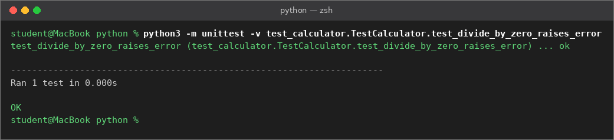

**Windows**

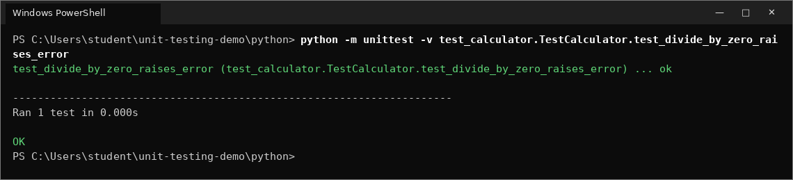

## A7. Let a test find a bug

Now the fun part. Open `calculator.py` and **break** `subtract` on purpose by swapping `a` and `b`:

```python
    def subtract(self, a, b):
        return b - a      # BUG: should be a - b
```

This is a very realistic bug. The code still runs, and the app does not crash. It just quietly gives the wrong answer (10 - 4 now gives -6).

Run the tests again (without `-v` this time):

| macOS | Windows |
|---|---|
| `python3 -m unittest` | `python -m unittest` |

**macOS**

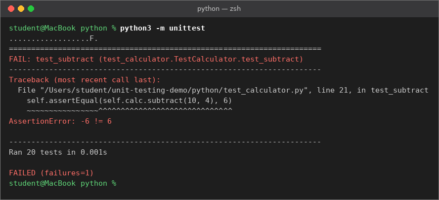

**Windows**

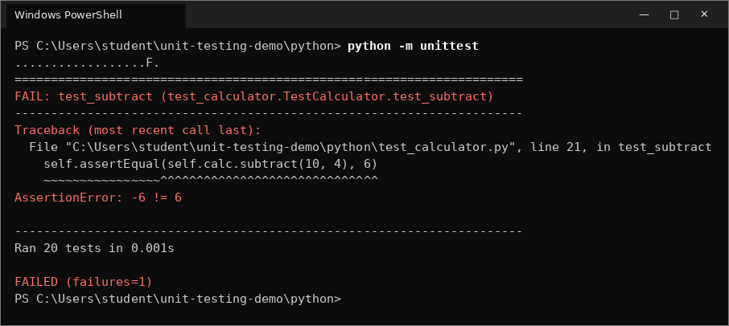

**How to read this failure, line by line:**

| Output | What it tells you |
|---|---|
| `.................F.` | 19 tests passed, 1 failed. |
| `FAIL: test_subtract` | The name of the failing test. Good test names tell you what broke without opening any file. |
| `File "...test_calculator.py", line 21` | The exact line of the assert that failed. |
| `AssertionError: -6 != 6` | **Actual** value `-6`, **expected** value `6`. The code gave `-6` but the test wanted `6`. |
| `FAILED (failures=1)` | Summary. Anything other than `OK` means stop and fix. |

Interesting detail: `test_subtract_order_matters` still passes, because `subtract(10, 4)` and `subtract(4, 10)` are still different numbers. One test is rarely enough. Several small tests catch more bugs.

**What happens if you do not have tests?** The bug ships. Every other part of the program that uses `subtract` gives wrong results, and nobody notices until a user complains.

**Now fix it:** change the line back to `return a - b` and run the tests again. You should see `OK`.

## A8. Remove a safety check and see an ERROR

Open `calculator.py` again and delete the two lines that protect `divide`:

```python
    def divide(self, a, b):
        # if b == 0:                                    <- deleted
        #     raise ValueError("Cannot divide by zero") <- deleted
        return a / b
```

Run the tests:

**macOS**

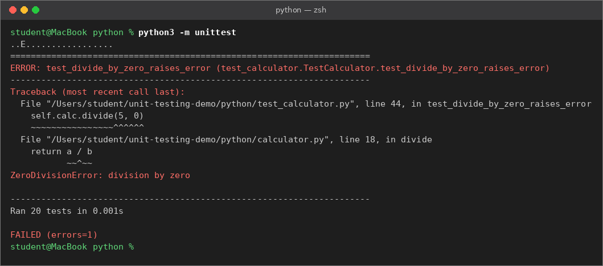

**Windows**

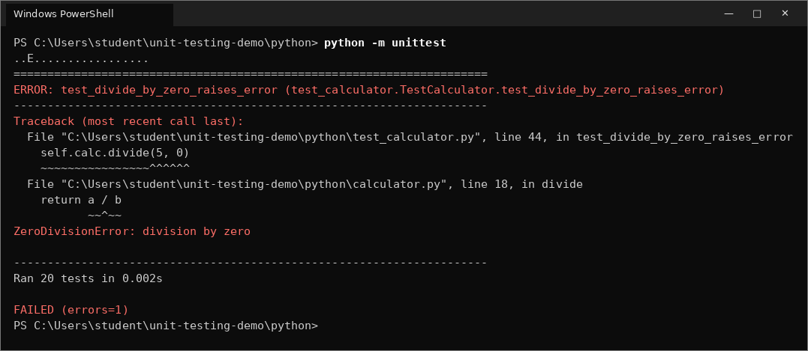

This time you see `E` and `ERROR`, not `F` and `FAIL`. The test expected a `ValueError`, but the code crashed with a different exception, `ZeroDivisionError`. The traceback shows the line inside `calculator.py` where it crashed.

**Why this matters:** without the check, the app would crash with a long red traceback when a user types 0, instead of showing a friendly message. The `assertRaises` test protects that behaviour, so nobody can delete the check by accident without the test going red.

**Put the two lines back** and confirm the tests show `OK` again.

## A9. Common Python mistakes

### Mistake 1: running the tests from the wrong folder

If you run the command from the main `unit-testing-demo` folder instead of the `python` folder:

**macOS**

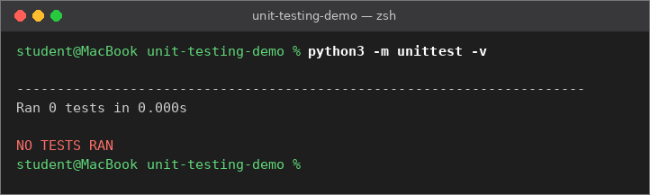

**Windows**

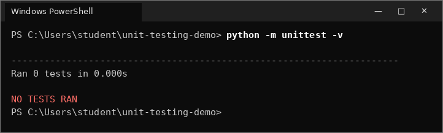

`Ran 0 tests` / `NO TESTS RAN` (Python older than 3.12 prints `OK` here, which is even more misleading). `unittest` looks for test files in the **current folder** and did not find any. Nothing is broken, you are just in the wrong place. Fix: `cd python` and run again.

### Mistake 2: forgetting the `test_` prefix

Rename one test so it no longer starts with `test_`:

```python
    def divide_by_zero_raises_error(self):    # missing "test_"
```

**macOS**

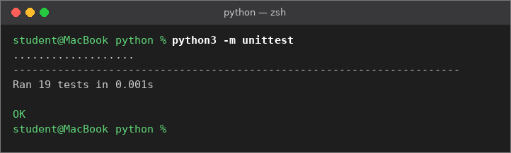

**Windows**

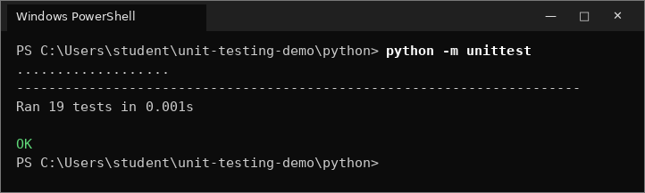

This one is sneaky. It says `OK`, so it looks fine. But look closely: **19 tests** instead of 20. That method was never run, so it protects nothing. If someone later deletes the divide-by-zero check, you get no warning. Always glance at the number of tests, not only at `OK`.

## A10. Python assert methods

All of these are called as `self.assertXxx(...)` inside a test class. Every one of them is used in `test_calculator.py`, so you can see a real example.

| Assert | Passes when | Example from this repo |
|---|---|---|
| `assertEqual(a, b)` | `a == b` | `self.assertEqual(self.calc.add(2, 3), 5)` |
| `assertNotEqual(a, b)` | `a != b` | `self.assertNotEqual(self.calc.subtract(10, 4), self.calc.subtract(4, 10))` |
| `assertTrue(x)` | `x` is `True` | `self.assertTrue(self.calc.is_even(4))` |
| `assertFalse(x)` | `x` is `False` | `self.assertFalse(self.calc.is_even(7))` |
| `assertAlmostEqual(a, b, places=n)` | `a` and `b` are equal when rounded to `n` decimal places | `self.assertAlmostEqual(self.calc.divide(1, 3), 0.3333333, places=6)` |
| `assertRaises(Error)` | the code inside the `with` block raises `Error` | `with self.assertRaises(ValueError): self.calc.divide(5, 0)` |
| `assertIn(item, list)` | `item` is inside `list` | `self.assertIn(4, self.calc.factors(12))` |
| `assertNotIn(item, list)` | `item` is not inside `list` | `self.assertNotIn(5, self.calc.factors(12))` |
| `assertIsNone(x)` | `x is None` | `self.assertIsNone(self.calc.largest([]))` |
| `assertIsNotNone(x)` | `x is not None` | `self.assertIsNotNone(self.calc.largest([3, 9, 2]))` |
| `assertGreater(a, b)` | `a > b` | `self.assertGreater(self.calc.power(5, 2), 5)` |
| `assertLess(a, b)` | `a < b` | `self.assertLess(self.calc.square_root(16), 16)` |
| `assertIsInstance(x, type)` | `x` is of that type | `self.assertIsInstance(self.calc.divide(10, 2), float)` |

**Why not just use `assertEqual` for decimals?** Computers store decimals approximately. In Python, `0.1 + 0.2 == 0.3` is `False` (try it). `assertAlmostEqual` allows a tiny difference so your test does not fail for the wrong reason.

**Why not just use `assertTrue(a == b)` everywhere?** It works, but when it fails it only says `False is not true`. `assertEqual(a, b)` tells you both values, for example `-6 != 6`, which makes the bug much faster to find. Use the most specific assert you can.

---

# Part B: Java

Java does not include a testing library, so this repository ships **JUnit 4** in the `java/lib` folder. You do not need to download anything.

Java code must be **compiled** (turned into `.class` files) before it can run. In this part you first do that by hand with `javac` and `java`, so you see what really happens. After that you can use the one-command shortcut scripts in the `java` folder, or the **Run** buttons in VS Code.

## B1. Check Java is installed

Run both commands (same on macOS and Windows):

```bash
java -version
javac -version
```

**What you should see:** a version number for both. Java 8 or newer works. Your version may differ from the screenshot.

**macOS**

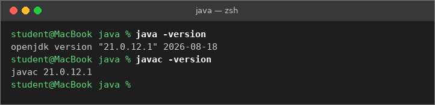

**Windows**

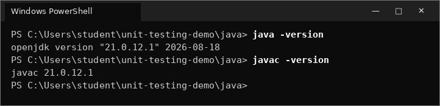

**If you see `'javac' is not recognized` (Windows) or `command not found` (macOS):** Java is not installed, or only the Java *runtime* is installed (it has no compiler). Install a JDK:

- **Windows:** run `winget install EclipseAdoptium.Temurin.21.JDK` in PowerShell, or download the JDK 21 `.msi` from <https://adoptium.net>. In the installer, set **"Add to PATH"** and **"Set JAVA_HOME"** to *"Will be installed"*.
- **macOS:** download the JDK 21 `.pkg` from <https://adoptium.net>, or run `brew install --cask temurin`.

Then **fully close and reopen VS Code or your terminal**. A window that was already open still uses the old settings and will keep saying "not recognized".

## B2. Look at the code

Move into the Java folder (from the main `unit-testing-demo` folder):

```bash
cd java
```

`src/Calculator.java` has the same methods as the Python version, using Java naming (`squareRoot`, `isEven`):

```java
public class Calculator {

    public int subtract(int a, int b) {
        return a - b;
    }

    public double divide(double a, double b) {
        if (b == 0) {
            throw new IllegalArgumentException("Cannot divide by zero");
        }
        return a / b;
    }
    ...
}
```

`src/Main.java` creates a `Calculator` and calls it from a menu, just like `main.py`.

## B3. Compile and run the calculator app

Go into the `src` folder, compile, and run:

| macOS | Windows |
|---|---|
| `cd src` | `cd src` |
| `javac *.java` | `javac *.java` |
| `java Main` | `java Main` |

(If you are in the main `unit-testing-demo` folder, use `cd java/src` on macOS or `cd java\src` on Windows.)

| Command | What it does |
|---|---|
| `javac *.java` | compiles **every** `.java` file in the folder. `Main` uses `Calculator`, so both must be compiled together. It prints nothing when it works. |
| `java Main` | runs the program. You give the **class name** `Main`, not the file name: no `.java`, no `.class`, no folder path. |

After `javac` you will see a new `.class` file next to each `.java` file. That is the compiled code Java actually runs.

Try option `1` with `7` and `5`, then `0` to exit.

**macOS**

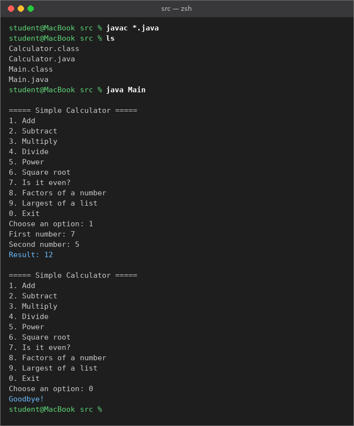

**Windows**

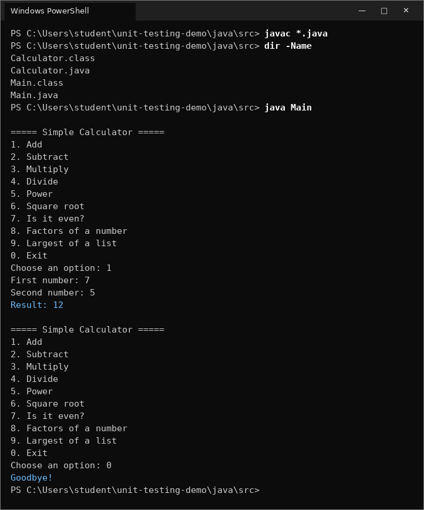

When you finish, go back to the `java` folder and remove the `.class` files so they do not clutter `src`:

| macOS | Windows |
|---|---|
| `rm *.class` then `cd ..` | `del *.class` then `cd ..` |

**Shortcut:** from the `java` folder, `.\run-app.bat` (Windows) or `bash run-app.sh` (macOS) compiles and runs in one step.

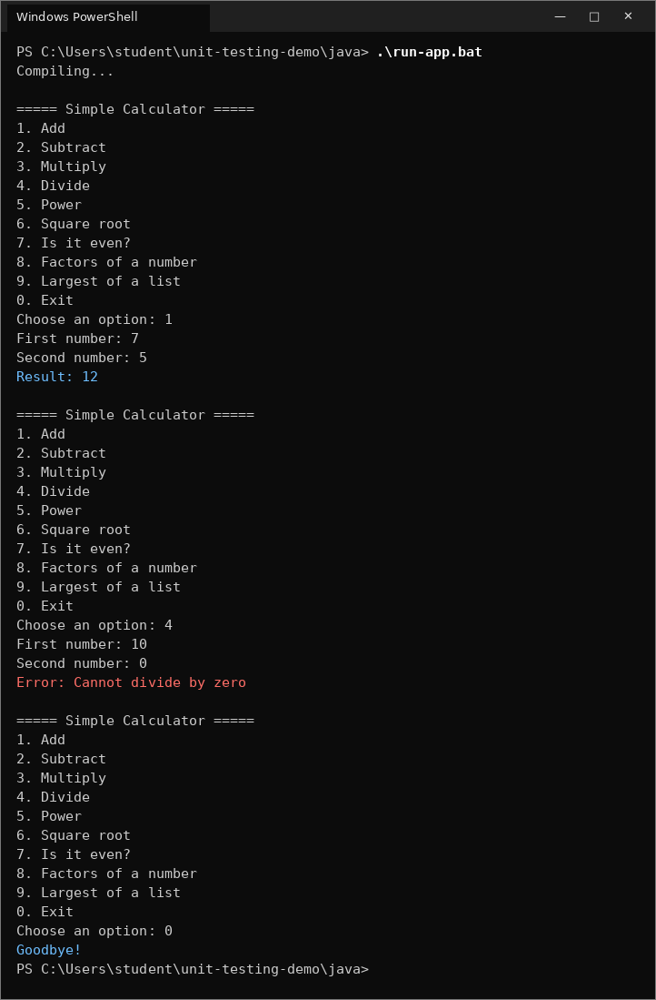

**In VS Code:** open `src/Main.java` and click **Run** just above `public static void main`. VS Code compiles and runs it for you.

## B4. Read a unit test

Open `test/CalculatorTest.java`:

```java
import static org.junit.Assert.*;       // 1. gives us assertEquals, assertTrue, ...
import org.junit.Before;
import org.junit.Test;

public class CalculatorTest {

    private Calculator calc;

    @Before                              // 2. runs before EVERY test
    public void setUp() {
        calc = new Calculator();
    }

    @Test                                // 3. marks this method as a test
    public void addTwoPositiveNumbers() {
        assertEquals(5, calc.add(2, 3));     // 4. assertEquals(EXPECTED, ACTUAL)
    }

    @Test
    public void divideByZeroThrowsException() {
        assertThrows(IllegalArgumentException.class, () -> calc.divide(5, 0));   // 5.
    }
}
```

1. **`import static org.junit.Assert.*`** lets you write `assertEquals(...)` instead of `Assert.assertEquals(...)`.
2. **`@Before`** is the Java version of Python's `setUp`: a fresh `Calculator` for every test.
3. **`@Test`** is how JUnit finds tests. In Java the annotation matters, not the method name. A method without `@Test` is ignored.
4. **Order matters:** JUnit is `assertEquals(expected, actual)`. If you swap them, the test still passes or fails correctly, but the failure message will say "expected" and "but was" the wrong way round and confuse you.
5. **`assertThrows`** checks that bad input is rejected. The `() -> ...` is a lambda: a small piece of code that JUnit runs for you and watches for the exception.

## B5. Run all the tests

The tests use JUnit, which lives in `lib`, so this time we must tell Java where to find it. Make sure you are in the `java` folder (not `src`), then run two commands:

**macOS**

```bash
javac -d out -cp lib/junit-4.13.2.jar src/*.java test/*.java
java -cp "out:lib/junit-4.13.2.jar:lib/hamcrest-core-1.3.jar" org.junit.runner.JUnitCore CalculatorTest
```

**Windows**

```powershell
javac -d out -cp lib\junit-4.13.2.jar src\*.java test\*.java
java -cp "out;lib\junit-4.13.2.jar;lib\hamcrest-core-1.3.jar" org.junit.runner.JUnitCore CalculatorTest
```

| Part | Meaning |
|---|---|
| `-d out` | put all compiled `.class` files in a folder called `out`, instead of next to the source files |
| `-cp ...` | **classpath**: where Java should look for code. The tests import JUnit, so the JUnit `.jar` files must be on it. |
| `src/*.java test/*.java` | compile the app and the tests together |
| `:` vs `;` | separator between classpath entries. **macOS uses `:`, Windows uses `;`.** |
| `"..."` quotes | needed on Windows PowerShell, where `;` would otherwise end the command |
| `org.junit.runner.JUnitCore CalculatorTest` | start JUnit's test runner and tell it which test class to run |

**What you should see:** one dot per test and `OK (17 tests)`.

**macOS**

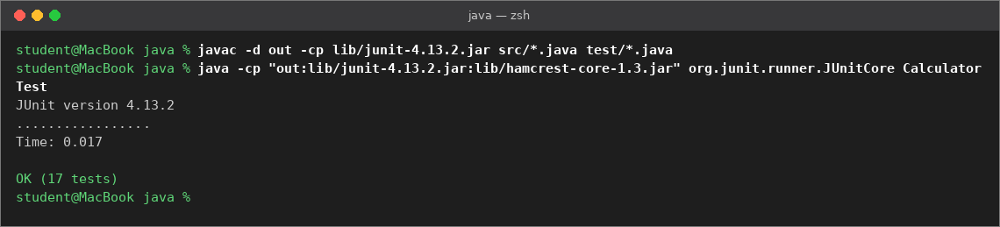

**Windows**

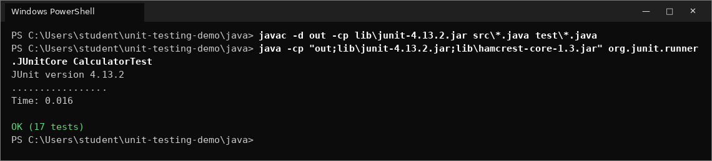

**Shortcut:** those two long commands are exactly what the script does. From the `java` folder:

| macOS | Windows |
|---|---|
| `bash run-tests.sh` | `.\run-tests.bat` |

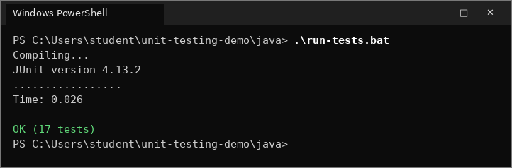

In JUnit 4 output a `.` is a test that started. A failing test adds an `E` right after its dot.

**In VS Code:** open `test/CalculatorTest.java`. Click the green triangle next to `public class CalculatorTest` to run all tests, or the one next to a single `@Test` method to run just that test. A green tick or a red cross appears beside each test. The **Testing** panel (the flask icon in the left bar) shows the same results as a list.

**Why this matters:** `OK (17 tests)` means 17 checks passed in a fraction of a second. Checking the same things by hand in the menu would take several minutes.

## B6. Let a test find a bug

Open `src/Calculator.java` and break `subtract`:

```java
    public int subtract(int a, int b) {
        return b - a;     // BUG: should be a - b
    }
```

Save the file, then compile and run the tests again (the same two commands as B5, or the script):

**macOS**

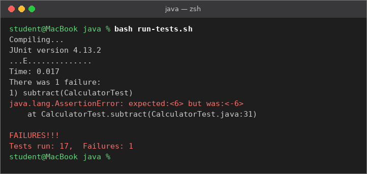

**Windows**

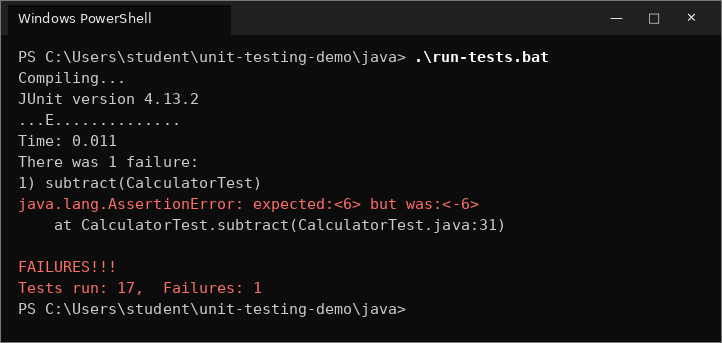

**How to read this failure:**

| Output | What it tells you |
|---|---|
| `...E.............` | the 3rd test failed |
| `1) subtract(CalculatorTest)` | the failing test method is `subtract` in `CalculatorTest` |
| `expected:<6> but was:<-6>` | the test wanted `6`, the code returned `-6` |
| `at CalculatorTest.subtract(CalculatorTest.java:31)` | file and line number of the failing assert |
| `FAILURES!!! Tests run: 17, Failures: 1` | summary |

**What happens if you do not have tests?** The program still runs and never crashes. It just quietly gives wrong answers, and nobody notices until a user complains.

> **Important:** after every change, compile again before running the tests. If you skip `javac`, Java runs the **old** `.class` files and you will see `OK (17 tests)` even though the code is broken. The scripts always compile first, so they avoid this.

**Now fix it:** change it back to `return a - b;`, save, compile, and run the tests again. You should see `OK (17 tests)`.

## B7. Common Java mistakes

### Mistake 1: compiling only one file by hand

If you compile only `Main.java` instead of `*.java`:

**macOS**

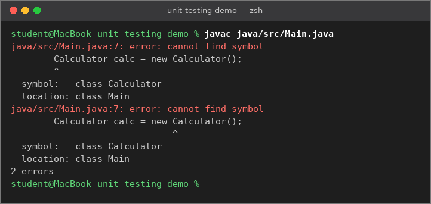

**Windows**

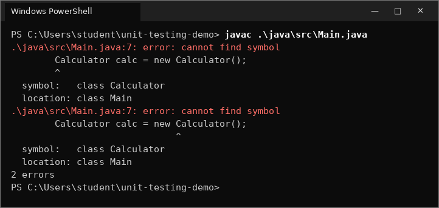

`cannot find symbol ... class Calculator`. `Main` uses `Calculator`, but `Calculator.java` is a different file and javac was not given it. Fix: compile all files together with `javac *.java` (or `src\*.java`).

### Mistake 2: giving `java` a file path

`java .\java\src\Main` gives `Could not find or load main class`. The `java` command expects a **class name** (`Main`), not a file path, and it only runs code that has already been compiled. Fix: compile first, then run `java Main` from the folder that holds `Main.class` (see B3).

### Mistake 3: forgetting `@Test`

A method without `@Test` above it is never run, just like a Python method without the `test_` prefix. Watch the test count: if you wrote 18 tests and JUnit says `OK (17 tests)`, one of them is missing its `@Test`.

## B8. JUnit assert methods

All of these come from `import static org.junit.Assert.*;`. Remember: **expected first, actual second.**

| Assert | Passes when | Example from this repo |
|---|---|---|
| `assertEquals(expected, actual)` | the two values are equal | `assertEquals(5, calc.add(2, 3));` |
| `assertEquals(expected, actual, delta)` | two `double`s differ by at most `delta` | `assertEquals(0.333333, calc.divide(1, 3), 0.000001);` |
| `assertEquals("message", expected, actual)` | same as above, and prints your message on failure | `assertEquals("2 + 2 should be 4", 4, calc.add(2, 2));` |
| `assertNotEquals(a, b)` | the values are different | `assertNotEquals(calc.subtract(10, 4), calc.subtract(4, 10));` |
| `assertTrue(condition)` | condition is `true` | `assertTrue(calc.isEven(4));` |
| `assertFalse(condition)` | condition is `false` | `assertFalse(calc.isEven(7));` |
| `assertThrows(Type.class, () -> code)` | the code throws that exception | `assertThrows(IllegalArgumentException.class, () -> calc.divide(5, 0));` |
| `assertArrayEquals(expected, actual)` | two arrays have the same items in the same order | `assertArrayEquals(new int[]{1, 2, 3, 6}, calc.factors(6));` |
| `assertNull(x)` | `x` is `null` | `assertNull(calc.largest(new int[]{}));` |
| `assertNotNull(x)` | `x` is not `null` | `assertNotNull(calc.largest(new int[]{3, 9, 2}));` |
| `assertSame(a, b)` | `a` and `b` are the very same object in memory | (opposite of the next row) |
| `assertNotSame(a, b)` | `a` and `b` are different objects, even if they look equal | `assertNotSame(calc.factors(6), calc.factors(6));` |
| `fail("message")` | never passes; marks a spot the test should not reach | used rarely, for custom checks |

**Why does `assertEquals` on `double` need a delta?** Computers store decimals approximately. `1.0 / 3` is not exactly `0.333333`. The delta says "close enough is fine". Without it, JUnit 4 will refuse to compare doubles.

**Why does `assertArrayEquals` exist?** For arrays such as `int[]`, `assertEquals(array1, array2)` checks whether they are the **same object**, not whether they contain the same items. Two separate arrays `{1, 2, 3, 6}` would fail. `assertArrayEquals` compares item by item, which is what you want.

---

## FAIL vs ERROR

| | FAIL | ERROR |
|---|---|---|
| Python shows | `F`, `FAIL:`, `AssertionError` | `E`, `ERROR:`, some other exception |
| Java (JUnit 4) shows | `java.lang.AssertionError: expected:<..> but was:<..>` | the real exception, e.g. `ArithmeticException` |
| Meaning | the code ran but gave the **wrong answer** | the code **crashed** before the check finished |
| Example in this repo | A7 / B6: subtract returns `-6` | A8: divide by zero crashes |

Both mean: stop and fix before moving on.

## Python vs Java side by side

| Idea | Python `unittest` | Java JUnit 4 |
|---|---|---|
| Test class | `class TestCalculator(unittest.TestCase)` | `public class CalculatorTest` |
| Mark a test | name starts with `test_` | `@Test` annotation |
| Fresh setup per test | `def setUp(self)` | `@Before public void setUp()` |
| Check equal | `self.assertEqual(actual, expected)` | `assertEquals(expected, actual)` |
| Check decimal | `assertAlmostEqual(a, b, places=6)` | `assertEquals(a, b, 0.000001)` |
| Check exception | `with self.assertRaises(ValueError):` | `assertThrows(IllegalArgumentException.class, () -> ...)` |
| Check nothing returned | `assertIsNone(x)` | `assertNull(x)` |
| Run the app | `python main.py` | `javac *.java` then `java Main` |
| Run all tests | `python -m unittest -v` | `javac` + `java ... JUnitCore CalculatorTest` (or the run-tests script) |
| Need to compile first? | No | Yes, every time the code changes (the scripts and VS Code do it for you) |

## Exercises

Try these in both languages. Write the test **first**, run it, and check it fails for the reason you expect before you change any code.

1. **Missing test.** There is no test for `multiply` with two negative numbers. Add one (`-3 * -4` should be `12`).
2. **Boundary value.** Add a test that `is_even(0)` / `isEven(0)` is `True`. Is zero even? (It is.)
3. **Find the bug yourself.** Ask a classmate to secretly break one method in `calculator.py` or `Calculator.java`. Run the tests and use only the failure message to find and fix it.
4. **Weak test.** `test_subtract_order_matters` kept passing even when `subtract` was broken (A7). Explain why, and write a stronger test.
5. **New feature, test first.** Add a method `average(numbers)` that returns the mean of a list. Write three tests first: a normal list, a list with one number, and an empty list (decide what it should return or raise). Then write the code until all three pass.
